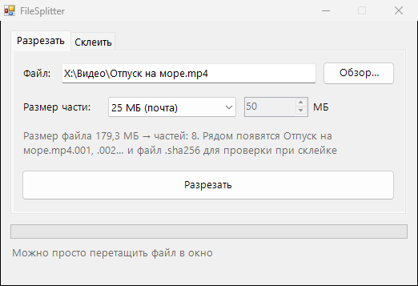

<div align="center">

# ✂️ FileSplitter

**Режет большой файл на части нужного размера и склеивает обратно с проверкой целостности**




</div>

## ✨ Возможности

- 📦 Готовые размеры частей: 25 МБ (лимит почты), 100 МБ, 500 МБ, 1 ГБ, 4 ГБ (лимит флешки с FAT32) или свой
- 🧩 Части называются `файл.001`, `файл.002`… Для склейки выбери любую из них, остальные найдутся сами
- 🔐 При разрезании сохраняется SHA-256 исходного файла, а после склейки результат проверяется. Если часть повреждена, программа об этом скажет
- 🛡️ Исходный файл не трогается. При склейке сначала пишется временный файл, и только после проверки он получает настоящее имя
- 🖱️ Перетащи файл в окно: обычный откроется во вкладке «Разрезать», часть `.001` во вкладке «Склеить»
- 🤝 Формат совместим с 7-Zip и Total Commander: их части `.001` тоже склеиваются

## 💡 Когда пригодится

- Отправить большое видео почтой или в мессенджере с лимитом на размер файла
- Записать файл больше 4 ГБ на флешку с FAT32
- Перенести файл частями через облако с ограничением

## 📥 Установка

1. Скачай `FileSplitter.exe` из раздела [**Releases**](../../releases/latest)
2. Запусти его, установка не нужна

## 🛠️ Сборка из исходников

Нужен только Windows: компилятор C# входит в состав .NET Framework.

```bat
build.bat
```

## 📄 Лицензия

[MIT](LICENSE)
